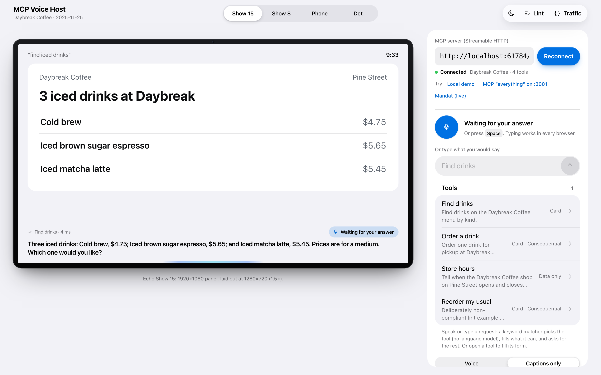
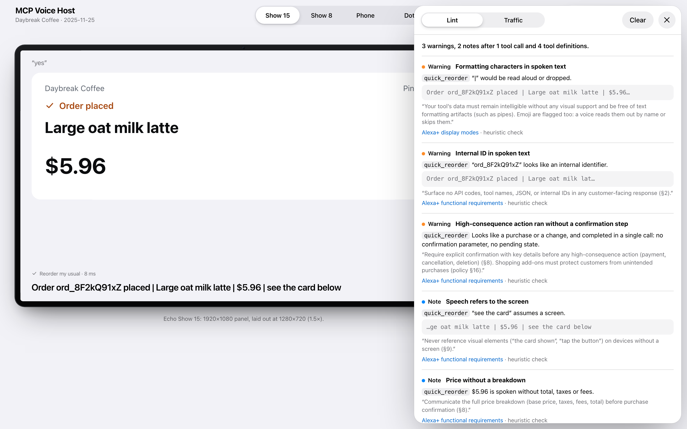
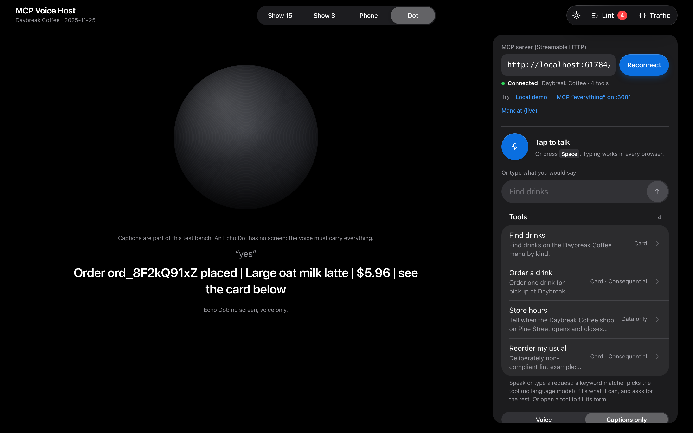
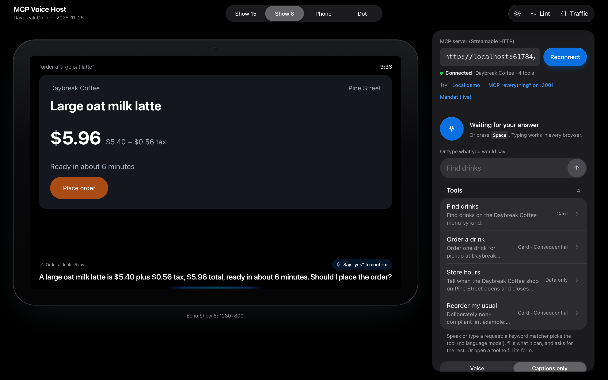
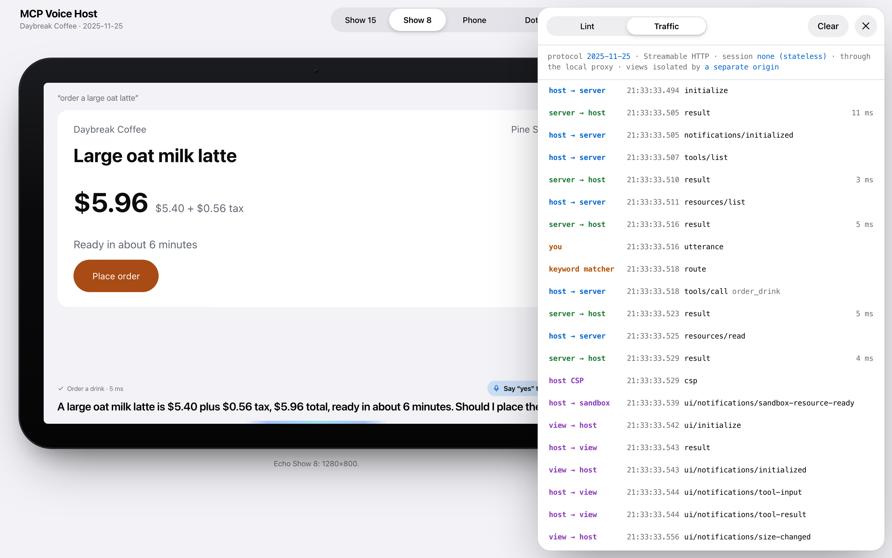

# mcp-voice-host

**Test any MCP server as an Alexa+-style voice add-on, in your browser, with no account and no build step.**

`mcp-voice-host` is a small, framework-free, voice-first [MCP Apps](https://github.com/modelcontextprotocol/ext-apps) host. Point it at any Streamable HTTP MCP server, talk to it (or type), and see what an Alexa+ device would say and show: on an Echo Show 15, an Echo Show 8, the phone app, and a screenless Echo Dot where the voice has to carry everything. A lint panel checks every tool result against Amazon's public Alexa+ add-on design guide, with a link to the exact guideline.



```sh
npx github:blanco1er/mcp-voice-host --demo                         # bundled demo server, opens your browser
npx github:blanco1er/mcp-voice-host --server https://example.com/mcp
```

Node 20 or later. Zero dependencies. MIT.

---

## Why

Alexa+ add-ons can be built on MCP, and Amazon documents how they should behave in its [MCP add-on design guide](https://developer.amazon.com/docs/alexaplus/add-ons/mcp-addon-design-guide-overview.html) and [functional requirements](https://developer.amazon.com/docs/alexaplus/add-ons/functional-requirements.html). The tools that let you *see* an add-on on a device, the [Web Simulator](https://developer.amazon.com/docs/alexaplus/add-ons/test-with-web-simulator.html) and the [Local Inspector](https://developer.amazon.com/docs/alexaplus/add-ons/mcp-toolkit-local-inspector.html), live behind the developer console and the Alexa+ add-ons Private Preview: Amazon's [development stages](https://developer.amazon.com/docs/alexaplus/add-ons/alexa-plus-add-on-development-stages.html) page says you "request access to the Private Preview. After approval, you receive credentials and install the tooling" (read on 18 Oct. 2026; the Local Inspector package is not on the public npm registry).

So most MCP developers today cannot check, before they apply, whether their server:

- answers with text that a voice can actually say (no pipes, IDs, URLs, JSON);
- still makes sense on a device with no screen;
- asks before it spends money;
- renders its MCP Apps card at Echo Show sizes, in light and dark.

`mcp-voice-host` is that missing loop, open source and local. It complements Amazon's tooling, it does not replace it: certification and real devices remain the reference.

## What you get

| | |
|---|---|
| **Any MCP server** | Streamable HTTP, protocol `2025-11-25`: `initialize`, `tools/list`, `resources/list`, `resources/read`, `tools/call`, session ids, SSE and JSON replies, server requests in the middle of a stream (elicitation, ping, roots). |
| **Voice in, voice out** | Web Speech API for listening, `speechSynthesis` for speaking, word-by-word highlighting. TTS is a provider interface: plug your own endpoint (for example Amazon Polly) with `--tts-url`, or switch to captions only. |
| **A voice loop without an LLM** | A transparent keyword matcher picks the tool, fills enums, numbers and one free-text argument, asks for missing ones by voice, and understands "yes" after a quote (it re-calls the tool with the confirmation token the server returned). Plug a real model with `--brain-url`. |
| **MCP Apps, done by the spec** | `ui://` resources rendered in a double-iframe sandbox on a separate origin, CSP built from `_meta.ui.csp` (sent as an HTTP header), the full host bridge: `ui/initialize`, tool input and result, `host-context-changed`, `size-changed`, `tools/call` with visibility checks, `ui/message`, `ui/open-link`, `ui/update-model-context`, display modes, teardown. |
| **Device frames** | Echo Show 15, Echo Show 8, phone, and Echo Dot (no screen: captions only, and screen references become lint errors). Each sends its own `hostContext`, including the fields Amazon documents for Alexa (`deviceClass`, `maxWidth`, `maxHeight`, `isMobile`). |
| **Voice lint** | 24 rules, each citing the Amazon or MCP page it comes from (table below). |
| **Traffic inspector** | Every JSON-RPC message between page, server, sandbox and view, with timings. |
| **Two ways to run** | The CLI (proxy + sandbox origin), or any static web server: `web/` is plain HTML, CSS and ES modules. |

<table>
<tr>
<td></td>
<td></td>
</tr>
<tr>
<td></td>
<td></td>
</tr>
</table>

## Quick start

```sh
# 1. The bundled demo (a fictional coffee shop, four tools, one MCP App card)
npx github:blanco1er/mcp-voice-host --demo
#   then say or type: "find iced drinks", "order a large oat latte", "yes", "reorder my usual"

# 2. The official MCP "everything" reference server
PORT=3001 npx @modelcontextprotocol/server-everything streamableHttp
npx github:blanco1er/mcp-voice-host --server http://localhost:3001/mcp
#   "echo hello from the kitchen", "get sum of 2 and 3", "trigger elicitation request"

# 3. A live Alexa+ add-on built for the Amazon "Build, Ship, Shape" hackathon (MCP Apps cards)
npx github:blanco1er/mcp-voice-host --server https://fonzkp2f5pszfit6xmqqiw7qdm0dybyu.lambda-url.us-east-1.on.aws/mcp
#   "household status"
```

From a clone: `node bin/mcp-voice-host.mjs --demo`. Without the CLI, serve `web/` with any static server and open `index.html?server=<url>` (the MCP server must then allow your page's origin, and Views are isolated by an opaque origin instead of a second one).

| Option | |
|---|---|
| `--server <url>` | MCP endpoint to open |
| `--demo` | also start the Daybreak Coffee demo server and connect to it |
| `--port <n>`, `--sandbox-port <n>` | host port (default 4280) and sandbox port (default: any free port) |
| `--header "Name: value"` | add a header to every MCP request (repeatable) |
| `--bearer-env NAME` | send `Authorization: Bearer $NAME`; the token never reaches the page |
| `--tts-url <url>` | text to speech: `POST {text, voice}` returns audio |
| `--brain-url <url>` | routing: `POST {utterance, tools, context}` returns `{tool, arguments}` or `{say}` |
| `--no-proxy`, `--no-open` | talk to the server directly from the page; do not open a browser |

URL parameters, handy for demos and CI: `server`, `device` (`show15`, `show8`, `phone`, `dot`), `theme` (`light`, `dark`), `tts=captions`, `inspector` (`lint`, `traffic`), and `say` (repeatable: each line is played as a turn).

Keyboard: <kbd>Space</kbd> talk, <kbd>L</kbd> lint, <kbd>T</kbd> traffic, <kbd>Esc</kbd> close.

## How it works

```
 browser page (host origin, :4280)                      local CLI                     your MCP server
 ┌──────────────────────────────────────┐   POST /proxy (token)   ┌──────────┐  Streamable HTTP  ┌──────────┐
 │ voice in ─ keyword matcher / brain   │ ───────────────────────▶│  proxy   │──────────────────▶│ tools    │
 │ MCP client (2025-11-25)              │ ◀───── JSON or SSE ──────│ no Origin│◀──────────────────│ ui://    │
 │ lint · traffic · TTS provider        │                          └──────────┘                   └──────────┘
 │ ┌──────────────────────────────────┐ │
 │ │ sandbox proxy (other origin,     │ │  postMessage: ui/notifications/sandbox-*, then every
 │ │ :sandbox port, CSP header)       │ │  MCP Apps message relayed both ways
 │ │ ┌──────────────────────────────┐ │ │
 │ │ │ View: the server's ui:// HTML│ │ │
 │ │ └──────────────────────────────┘ │ │
 │ └──────────────────────────────────┘ │
 └──────────────────────────────────────┘
```

1. **Connect.** The page sends `initialize` with protocol `2025-11-25`, the `elicitation` capability and the MCP Apps extension (`io.modelcontextprotocol/ui`), then `notifications/initialized`, `tools/list` and `resources/list`. Tool definitions are linted at once.
2. **A turn.** Speech (or text) goes to the router. The keyword matcher scores tools by name and title (weight 3), parameter names and description words, never picks tools whose `_meta.ui.visibility` excludes `"model"`, fills what it can and asks for each missing required argument by voice ("Which size: small, medium or large?").
3. **Safety.** If a tool looks like a purchase or a change (`destructiveHint`, or verbs such as *order*, *pay*, *cancel*, unless *get/list/status…* or `readOnlyHint`) and has no confirmation parameter, the host asks you before running it. The lint then reports it, because the add-on should have asked.
4. **The answer.** The first `text` block of the result is what the device says. If the result names a `ui://` resource and the device has a screen, the View is rendered; otherwise the host shows the data plainly, as Alexa does for data-only ("hydrated") responses. On the Dot, nothing is drawn: you get the voice, captions, and the lint.
5. **Follow-ups.** When an answer ends with a question, the next utterance answers it. A "yes" calls the same tool again with the values the result handed back (a `confirmation_token`, a `plan.id` mapped to `plan_id`), or a confirm-like tool such as `confirm_plan`, with your exact words in a `user_confirmation` parameter if it has one.

### hostContext sent to Views

| Field | Show 15 | Show 8 | Phone | Dot |
|---|---|---|---|---|
| Screen layout (CSS px) | 1280×720, scaled 1.5× to the 1920×1080 panel | 1280×800 | 390×844 | none |
| `platform`, `isMobile` | web, false | web, false | mobile, true | web, false |
| `deviceCapabilities` | touch | touch | touch | none |
| `safeAreaInsets` | 0 | 0 | 47 / 34 | 0 |
| `availableDisplayModes` | inline, fullscreen | inline, fullscreen | inline, fullscreen | none |

Every View also gets `theme`, `displayMode`, `containerDimensions` (`width` fixed, `maxHeight` flexible), `locale`, `timeZone`, `userAgent`, a few standard `styles.variables`, `toolInfo`, and Alexa's `deviceClass`, `maxWidth`, `maxHeight`. Field names come from the [MCP Apps spec](https://github.com/modelcontextprotocol/ext-apps/blob/main/specification/2026-01-26/apps.mdx) and Amazon's [Layout and Rendering](https://developer.amazon.com/docs/alexaplus/add-ons/mcp-addon-layout-and-rendering.html) page. **Not published by Amazon** (our choices): the exact `deviceClass` strings and the Echo Show 15 widget viewport. Amazon's [Visual foundations](https://developer.amazon.com/docs/alexaplus/add-ons/mcp-addon-visual-foundations.html) give a 768×480 base canvas and 1280×800 for the Echo Show 8.

## Lint rules

What the device says is the first text block of the tool result. "Heuristic" means a pattern match that can be wrong both ways: it points at something worth a look. Severities: error, warning, note.

| Rule | Severity | Checks | Source |
|---|---|---|---|
| `speech-formatting` | warning | pipes, Markdown, HTML tags, emoji in spoken text (heuristic) | [Display modes](https://developer.amazon.com/docs/alexaplus/add-ons/mcp-addon-display-modes.html): "free of text formatting artifacts (such as pipes)" |
| `speech-url` | warning | web or email addresses in spoken text (heuristic) | [Display modes](https://developer.amazon.com/docs/alexaplus/add-ons/mcp-addon-display-modes.html), voice-only baseline |
| `speech-ids` | warning | UUIDs, long hex, `ord_8F2kQ91xZ`-style tokens (heuristic) | [Functional requirements §2](https://developer.amazon.com/docs/alexaplus/add-ons/functional-requirements.html) |
| `speech-json` | warning | JSON as the text content (heuristic) | [Functional requirements §2](https://developer.amazon.com/docs/alexaplus/add-ons/functional-requirements.html) |
| `speech-tool-name` | warning | a tool name inside the answer (heuristic) | [Functional requirements §2](https://developer.amazon.com/docs/alexaplus/add-ons/functional-requirements.html) |
| `speech-length` | warning | more than 30 s at 150 words a minute (heuristic) | [Functional requirements §9](https://developer.amazon.com/docs/alexaplus/add-ons/functional-requirements.html) |
| `speech-screen-ref` | error on Dot, note elsewhere | "see the card", "tap", "on screen" (heuristic) | [Functional requirements §9](https://developer.amazon.com/docs/alexaplus/add-ons/functional-requirements.html) |
| `speech-options` | warning | more than five options read out (heuristic) | [Functional requirements §9](https://developer.amazon.com/docs/alexaplus/add-ons/functional-requirements.html) |
| `voice-only-incomplete` | error on Dot, warning elsewhere | a card or data with almost nothing to say (heuristic) | [Display modes](https://developer.amazon.com/docs/alexaplus/add-ons/mcp-addon-display-modes.html), [§9](https://developer.amazon.com/docs/alexaplus/add-ons/functional-requirements.html) |
| `result-empty` | error | no content and no structuredContent | [Tools, schema and data design](https://developer.amazon.com/docs/alexaplus/add-ons/mcp-addon-tools-schema-data-design.html): "Always return something" |
| `error-jargon` | warning | HTTP codes, exceptions, raw JSON in an error (heuristic) | [Functional requirements §2](https://developer.amazon.com/docs/alexaplus/add-ons/functional-requirements.html) |
| `error-next-step` | note | an error that says what failed but not what to do (heuristic) | [Functional requirements §2](https://developer.amazon.com/docs/alexaplus/add-ons/functional-requirements.html) |
| `purchase-no-confirmation` | warning | a purchase-like tool that completed in one call, with no confirmation parameter or pending state (heuristic) | [Functional requirements §8](https://developer.amazon.com/docs/alexaplus/add-ons/functional-requirements.html), [Policy §16](https://developer.amazon.com/docs/alexaplus/add-ons/policy-requirements.html) |
| `purchase-breakdown` | note | a price spoken without total, tax or fees (heuristic) | [Functional requirements §8](https://developer.amazon.com/docs/alexaplus/add-ons/functional-requirements.html) |
| `slow-call` | warning | round trip over 3 s (and whether `_meta.ui.invoking` is declared) | [Functional requirements §7, §2](https://developer.amazon.com/docs/alexaplus/add-ons/functional-requirements.html) |
| `cross-modal-amount` | warning | an amount spoken but absent from structuredContent (heuristic) | [Functional requirements §10](https://developer.amazon.com/docs/alexaplus/add-ons/functional-requirements.html) |
| `tracking-params` | warning | `utm_`, `gclid`, `fbclid`… in the payload | [Tools, schema and data design](https://developer.amazon.com/docs/alexaplus/add-ons/mcp-addon-tools-schema-data-design.html) |
| `ui-mime` | error | UI resource not served as `text/html;profile=mcp-app` | [MCP Apps spec](https://github.com/modelcontextprotocol/ext-apps/blob/main/specification/2026-01-26/apps.mdx) |
| `ui-uri-hash` | note | `ui://` URI without a version or content hash (heuristic) | [Layout and rendering](https://developer.amazon.com/docs/alexaplus/add-ons/mcp-addon-layout-and-rendering.html) |
| `ui-no-initialize` | warning | the View never sent `ui/notifications/initialized` within 3 s | [MCP Apps spec](https://github.com/modelcontextprotocol/ext-apps/blob/main/specification/2026-01-26/apps.mdx) |
| `tool-description` | warning | missing or very short tool description (heuristic) | [Tools, schema and data design](https://developer.amazon.com/docs/alexaplus/add-ons/mcp-addon-tools-schema-data-design.html) |
| `tool-schema` | error | `inputSchema` missing, not an object, or required keys not declared | [Functional requirements §13](https://developer.amazon.com/docs/alexaplus/add-ons/functional-requirements.html) |
| `tool-param-description` | note | parameters without a description | [Functional requirements §13](https://developer.amazon.com/docs/alexaplus/add-ons/functional-requirements.html) |
| `tool-overlap` | note | two tools whose names and descriptions share most of their words (heuristic) | [Tools, schema and data design](https://developer.amazon.com/docs/alexaplus/add-ons/mcp-addon-tools-schema-data-design.html) |

The demo's `quick_reorder` tool breaks several rules on purpose, so you can see them fire.

## Security model

- **Views** run in an inner iframe inside a sandbox proxy served from a *different origin* (a second local port), as the MCP Apps spec requires for web hosts. The proxy checks who embeds it and that it cannot reach the host page. The CSP is the spec's restrictive default plus the domains declared in `_meta.ui.csp`; entries that are not plain origins are dropped, so a resource cannot inject `'unsafe-eval'` or a new directive. Views can only call tools whose visibility includes `"app"`, open only `http(s)` links, and never reach the host's DOM.
- **The proxy** listens on loopback only, requires a random per-run token that only a page served by this host can read (no CORS on `/config.json`), refuses other `Origin`s and cross-site `Sec-Fetch-Site`, rejects non-loopback `Host` headers (DNS rebinding), forwards only MCP headers, and never sends the browser's `Origin` upstream. Headers given with `--header` or `--bearer-env` are added server side and never shown to the page.
- **Consequential tools** get a host-side confirmation when the server has none of its own. This protects you while testing a real server; it is not a substitute for the add-on's own confirmation.

## Limitations

- **Not Alexa.** There is no language model by default: routing is keyword based, and the device says the first text block verbatim, while Alexa+ composes its own speech from your data. This makes the host strict (useful for a voice-only check) but not identical. Plug a model with `--brain-url` for closer behavior.
- **Not Amazon's renderer.** Alexa's native components for data-only results, its exact `hostContext` values and its device viewports are not public; the host approximates them and says so. Final testing belongs on real devices and in Amazon's own tools.
- **Lint rules are mostly heuristics** (marked as such). They do not certify anything.
- **Speech recognition** depends on the browser: Chrome, Edge and Safari support it; Firefox does not (type instead). In Chrome, recognition audio is processed by Google's servers.
- **Protocol coverage:** no `sampling`, no OAuth flow (use `--bearer-env`), no standalone `GET` SSE stream, no `pip` display mode, no streaming of partial tool input.

## Development

```sh
npm test                       # 46 tests, node --test, no dependencies
node examples/daybreak-coffee/server.mjs 4290   # the demo server alone
PLAYWRIGHT_CORE=… CHROME_PATH=… node scripts/screenshots.mjs   # regenerate docs/screenshots
```

```
bin/mcp-voice-host.mjs        CLI
server/serve.mjs              static host, /config.json, /proxy, /tts, /brain, sandbox origin
web/index.html, app.js        the host page
web/lib/mcp-client.js         Streamable HTTP client (browser and Node)
web/lib/bridge.js             MCP Apps host bridge, DOM-free
web/lib/apps-host.js          double-iframe sandbox wiring
web/lib/csp.js                CSP from _meta.ui.csp
web/lib/lint.js               voice lint rules with sources
web/lib/intent.js             keyword matcher, slot filling, follow-ups, HTTP brain
web/lib/tts.js, devices.js, schema-form.js
web/sandbox.html              sandbox proxy
web/design-system/            tokens, components, springs (Apple HIG 2026 based)
examples/daybreak-coffee/     zero-dependency demo MCP server and its MCP App card
test/                         client, proxy, bridge, CSP, lint, intent
```

See [CONTRIBUTING.md](CONTRIBUTING.md). New lint rules need a source link and a test.

## Hackathon note

Built as an open-source companion to *Mandat for Alexa+*, our entry in the Amazon "Build, Ship, Shape" hackathon on Devpost. The [official rules](https://amazonappdev2026.devpost.com/rules) define the Open Source mini-challenge as: "Create a new, additional open-source project or contribute to an existing public repository during the hackathon window, alongside a primary track submission." Their judging guidance names "meaningful feature addition with tests, bug fix that unblocks other developers, new integration pattern" as creative contributions. This repository was started on 18 October 2026, inside the submission window.

## License

[MIT](LICENSE). Not affiliated with or endorsed by Amazon. Alexa, Echo and Echo Show are trademarks of Amazon.com, Inc. or its affiliates; they are named here only to describe what the tool simulates.
